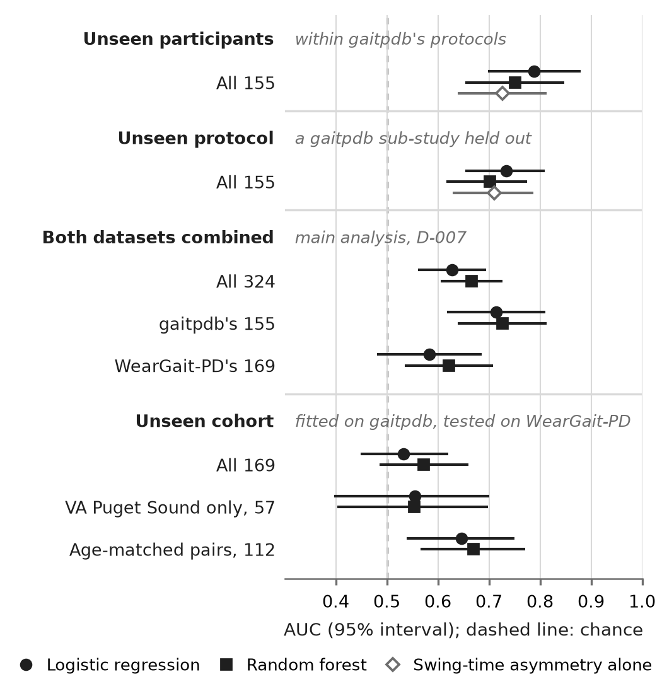
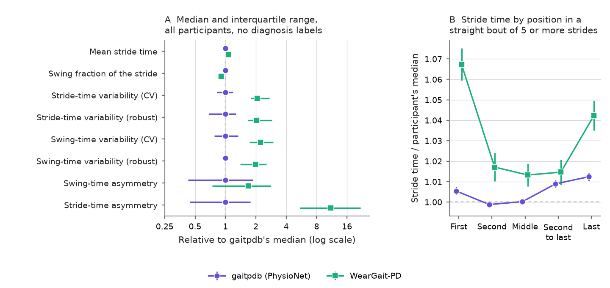
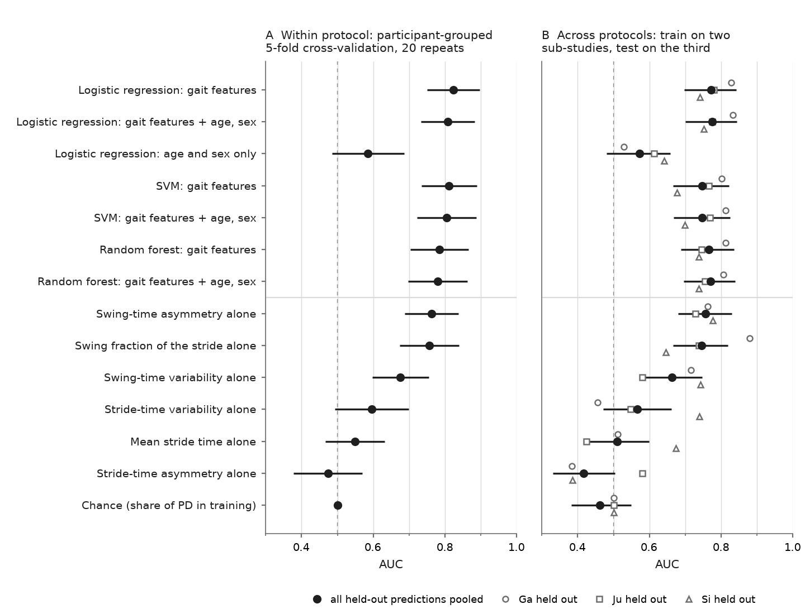

# Detecting Parkinson's disease from foot-force gait recordings

BMEN 600, Fall 2026, University of Calgary. Group 5 ("The Singing Oats"): Jamie Sanson, Anna Klygina, Yassien Tawfik.

> **Working in this repo?** People: read [CONTRIBUTING.md](CONTRIBUTING.md). AI agents: follow [CLAUDE.md](CLAUDE.md). Tasks and deadlines: [TASKS.md](TASKS.md). Group decisions: [DECISIONS.md](DECISIONS.md).

## Research question

Can a small set of interpretable gait timing features, computed from foot-force recordings alone and without clinical scores, separate people with Parkinson's disease (PD) from controls aged 50 and over when the classifier is tested on participants, recording protocols and cohorts it has never seen, and which features carry that separation?

The question and the plan to answer it are set out in the Midterm Research Plan, submitted on 16 October 2026; the wording above is the working version of the question in that plan. The code and results the plan reports are at commit [`50a86e9`](https://github.com/Jsanson1/BMEN600_Group5/tree/50a86e91b76335a20e14ba26ddeeb757b44c8a1c), and its Background, Preliminary Results and end statements are kept in [report/midterm/](report/midterm/).

## Why it matters

PD affects at least 1% of people over 60 and is the fastest-growing neurodegenerative disorder worldwide [1]. It is diagnosed on clinical grounds, and that diagnosis is wrong in roughly one case in five, with no improvement over 25 years and the poorest accuracy in early disease [2]. Gait is among the most common and disabling symptoms, it is rarely measured in routine care, and the gait changes of PD (shorter strides, higher stride-to-stride variability, left-right asymmetry) are well described at the group level [3], [4]. What is not settled is whether those changes separate an individual with PD from healthy ageing when a model is evaluated the way a screening tool would be used: on new people and new recording conditions. Published classifiers on the dataset below report accuracies above 95%, but many evaluate on recordings rather than participants, so the same person appears in training and test [5], [6]. This project measures how much of that performance survives a participant-level, cross-protocol and cross-cohort evaluation, using three classical models (logistic regression, support vector machine, random forest) on the same features.

## Data

| Dataset | Role | Access | Licence |
| --- | --- | --- | --- |
| PhysioNet "Gait in Parkinson's Disease" v1.0.0 [7], [8] | Development; combined with WearGait-PD in the main analysis and the training set for the cross-cohort test ([DECISIONS.md](DECISIONS.md), D-007). 93 PD and 73 controls, 306 recordings of about 2 min of self-paced walking with 8 force sensors under each foot at 100 Hz, three sub-studies (Ga, Ju, Si), Hoehn and Yahr and UPDRS scores. Of the 162 participants aged 50 or over who have a recording (91 PD, 71 controls; [DECISIONS.md](DECISIONS.md), D-006), the stride analyses use 155 (87 PD, 68 controls): one has no recorded walking speed, which locating the turns needs (D-008), and six have fewer than 40 clean strides on a foot in their usual walk (D-011). | Open, no account: <https://physionet.org/content/gaitpdb/1.0.0/> (DOI 10.13026/C24H3N) | ODC-By 1.0 |
| WearGait-PD [9] | Combined with PhysioNet in the main analysis, and the external test set for models trained on PhysioNet (D-007). 100 PD and 85 controls before the age rule, recorded by a different group with inertial sensors, pressure insoles and an instrumented walkway. The analyses use the total insole force of three self-paced walking tasks (SelfPace, SelfPace_mat and SelfPace_matTURN, Version 1), pooled with the turns removed, for 169 of the 181 participants aged 50 or over (94 PD, 75 controls): 11 have no insole data and one has fewer than 10 clean strides on a foot (D-011). | Synapse (syn52540892), free account and acceptance of the data-use terms required | CC BY 4.0 |

Data are never committed. Download steps, checksums and the known quirks of the files are in [data/raw/README.md](data/raw/README.md); the PhysioNet ZIP unpacks into `data/raw/gaitpdb/`, which git ignores.

## What is in the repository

| Path | What it holds |
| --- | --- |
| `src/gaitpdb/` | The shared Python package: `io.py` reads the record files and `demographics.txt`; `cohort.py` holds the group's age rule (D-006), which every analysis applies through it; `events.py` finds heel strikes and toe offs from the per-foot total force and flags which strides to keep; `features.py` defines the gait features (stride, swing and stance timing, their variability and robust variability, left-right asymmetry) and computes them for one recording (the midterm) or from one participant's clean strides (the final analyses; `results/feature_dictionary.md` explains every column); `forest.py` is the random forest whose depth and features per split are tuned by out-of-bag log-loss; `evaluation.py` fixes the model inputs, the participant-grouped and leave-one-study-out splits, the metrics and their intervals for all three models, and saves each model's results in the form the comparison reads; `crosscohort.py` adds the evaluations across the two datasets (DECISIONS.md D-007): the two combined in participant-grouped cross-validation, models trained on PhysioNet and tested once on WearGait-PD, the dataset-of-origin check, sensitivity at 90% specificity and the predictive values at a chosen prevalence, and the stride-matched resampling used to check the effect of stride count (D-011); `weargait.py` reads WearGait-PD's two participant sheets (age, sex, site, weight, assistive device); `walkway.py` matches the insole contacts found at a force threshold to the WearGait-PD walkway's own foot contacts, the check behind the choice of threshold. |
| `scripts/` | One script per output (see "How to run"). |
| `results/` | Tables and numbers produced by the scripts: `table1_participants.md`, `features_usual_walk.csv` (one row per usual-walk recording), `features_usual_walk_by_group.csv`, `figure1_summary.txt`, `event_detection_checks.txt`, `data_quality.txt`, `dual_task_check.txt`; `features_gaitpdb.csv` and `features_weargait.csv` (one row per included participant, from the clean strides), `feature_dictionary.md`, `features_summary.txt` and `feature_checks.txt` (the two datasets compared without WearGait-PD's diagnosis labels); for each model script a `*_summary.txt` and its fold metrics and predictions (`*_folds.csv`, `*_cv_predictions.csv`, `*_loso_predictions.csv`); `rf_importances.csv`, the random forest's permutation and impurity importances; `model_comparison.txt` (also `.md` and `.csv`), every model side by side, with sensitivity at 90% specificity and the predictive values at 1% prevalence; `crosscohort_summary.txt` (with `crosscohort_results.csv`, `crosscohort_pooled_folds.csv` and `crosscohort_predictions.csv`), the analyses across the two datasets; `weargait_signal_check.txt`, a post hoc check of how much the inputs separate the groups inside each dataset and of the age-matched analysis; `figure5_values.csv`, every value Figure 5 draws; `cohort_table.md` (also `.csv`), the participants of the final analysis in both datasets; `crosscohort_table.md` (also `.csv`), the cross-cohort test and each of its checks side by side; `fixed_20N/`, the 20 N sensitivity analysis (D-012); `weargait_participants.txt`, WearGait-PD's participants before and after the age rule, its task files and who enters the stride analyses by site and group; `weargait_threshold_check.txt` (also `.csv`, and `weargait_threshold_participants.csv` per participant), insole contacts at each candidate threshold against the walkway; and `weargait_files_downloaded.csv`, the WearGait-PD files analysed with their Synapse versions and MD5s. |
| `figures/` | Figure 1 (events and the two headline features), Figure 2 (the evaluation design), Figure 3 (the model comparison), Figure 4 (the two datasets compared without WearGait-PD's diagnosis labels) and Figure 5 (the main results, from unseen participants to an unseen cohort), PNG and PDF; `fixed_20N/` holds Figure 4 at 20 N. |
| `report/midterm/` | Markdown snapshots of the midterm sections that go with the code, and `sources.md`, the table of every reference with how it was verified and what it supports. |
| `data/raw/README.md` | How to obtain the data. |
| `members/`, `TASKS.md`, `DECISIONS.md` | Who did what, the task board, and the group's decisions (the paper's Author Contributions and AI-Assisted Work sections are written from `members/*/log.md`). |
| `CONTRIBUTING.md`, `CLAUDE.md`, `AGENTS.md` | How the team and its AI assistants work in this repository. |
| `requirements.txt`, `requirements-dev.txt`, `pyproject.toml` | Python dependencies and the ruff configuration; `.github/workflows/checks.yml` runs the same checks on every pull request. |

## How to run

Platform: plain Python scripts run from a terminal (no notebook or MATLAB), Python 3.11 or newer, packages numpy, pandas, scipy, scikit-learn, matplotlib and tabulate (`requirements.txt`). Tested on Linux; nothing in the code is platform-specific.

```bash
python -m pip install -r requirements.txt
# download and unpack the PhysioNet ZIP into data/raw/gaitpdb/ (see data/raw/README.md), then:
python scripts/verify_data.py            # every file against PhysioNet's SHA256SUMS.txt
python scripts/make_table1.py            # Table 1 -> results/table1_participants.{csv,md}, results/table1_notes.txt
python scripts/make_figure1.py           # Figure 1 -> figures/, plus results/features_usual_walk*.csv and results/figure1_summary.txt
python scripts/check_event_detection.py  # contact threshold (fixed, share of body weight, share of the recording's force) and stride-rule sensitivity -> results/event_detection_checks.{csv,txt}
python scripts/check_data_quality.py     # data-quality report -> results/data_quality.{txt,csv}
python scripts/check_dual_task.py        # does the pipeline reproduce the published dual-task effect? -> results/dual_task_check.txt
# after scripts/make_clean_strides.py (T-017) has written the clean strides to data/interim/:
python scripts/make_features.py         # participant features of both datasets -> results/features_{gaitpdb,weargait}.csv, results/feature_dictionary.md, results/features_summary.txt
python scripts/check_features.py        # the two datasets compared without WearGait-PD's diagnosis labels (shift, task pooling, straight bouts, stride count) -> results/feature_checks.txt, Figure 4 -> figures/
python scripts/make_figure2.py           # Figure 2, the evaluation design, its counts from the two feature tables -> figures/
python scripts/run_logreg.py             # logistic regression under the shared evaluation -> results/logreg_*.{txt,csv}
python scripts/run_random_forest.py      # random forest (tuned by out-of-bag log-loss) under the shared evaluation, with feature importances -> results/rf_*.{txt,csv}
python scripts/run_baselines.py          # chance and one-feature-at-a-time baselines on the same splits -> results/baselines_*.{txt,csv}
python scripts/compare_models.py         # every model side by side with paired tests, and Figure 3 -> results/model_comparison*, figures/
python scripts/run_cross_cohort.py       # the cross-dataset analyses for every model (pooled, cross-cohort, VA Puget Sound only, age-matched, standardised within dataset, dataset of origin, stride-matched reference) -> results/crosscohort_*
python scripts/check_weargait_signal.py  # post hoc: how much the inputs separate the groups inside each dataset, and two checks of the age-matched analysis -> results/weargait_signal_check.txt
python scripts/make_figure5.py           # Figure 5, the main results from unseen participants to an unseen cohort -> figures/, with every value drawn in results/figure5_values.csv
# with WearGait-PD's participant sheets and task files in data/raw/weargait_pd/ (see data/raw/README.md):
python scripts/check_weargait_participants.py  # participants, task files, and who enters the stride analyses by site -> results/weargait_participants.txt
python scripts/check_weargait_threshold.py     # insole contact thresholds against the walkway's footfalls -> results/weargait_threshold_*
python scripts/make_cohort_table.py            # the participants of the final analysis in both datasets, by group -> results/cohort_table.{csv,md}
# after the 20 N sensitivity analysis (the five 20 N steps of scripts/run_all.py):
python scripts/make_table_crosscohort.py       # the cross-cohort test and its checks, every model -> results/crosscohort_table.{csv,md}
```

`python scripts/run_all.py` runs all of them in order, then the 20 N sensitivity analysis into `results/fixed_20N/`; it takes about 85 to 90 minutes on a two-core machine, most of it the cross-dataset analyses and the random forest. Without the WearGait-PD files, which need a Synapse account, it runs only the steps that need PhysioNet alone (about 30 minutes), says which it skipped, and leaves every output that needs WearGait-PD as committed. The scripts that read the raw recordings accept `--data <folder>` if the data live elsewhere. `python -m pip install -r requirements-dev.txt && python -m pytest` runs the unit tests in `tests/` (synthetic signals, no dataset needed).

Every number, table and figure in the reports is produced by a script in `scripts/`. `run_all.py` rewrites every committed output except those of the exploration scripts behind the cleaning rules (`scripts/explore_*.py`, run separately, which write `results/explore_*` and `figures/explore_stride_rules/`) and `results/weargait_files_downloaded.csv`, which was written when the WearGait-PD files were downloaded. On the Linux setup below, a rerun from a clean checkout reproduces every output it writes byte for byte, except one line in each of the two `features_summary.txt` files, which names the commit the clean strides were made at; without the WearGait-PD files it changes no committed file at all. The full rerun was last checked at commit `aff8778` on 6 November 2026 (91 minutes, after Figure 5 and the two paper tables were added) and the PhysioNet-only rerun at `085c0cf` on 2 November 2026, both on Linux with Python 3.13, NumPy 2.5.3, pandas 3.0.5, SciPy 1.18.1, scikit-learn 1.9.1 and Matplotlib 3.11.2. A second member's full rerun of `87b45f5` on Windows 11 (Python 3.13, NumPy 2.5.4, pandas 3.1.1; 45 minutes on 24 cores) reproduced every reported number; there the files themselves differed in line endings, in the last digits of floating-point values in 21 CSV files (by at most 1e-13) and in the PNG files' bytes but not their pixels (`members/yassien/log.md`, 8 November 2026). Other operating systems and library versions have not been checked.

## Results

Each number below is quoted from the output file named with it; "How to run" lists the script that writes each file. The cross-dataset analysis and its inputs were committed before any model was scored against WearGait-PD's diagnoses (D-012, D-013); the check at the end of this section was written afterwards and is exploratory.

**Participants.** gaitpdb: 155 participants aged 50 or over (87 PD, 68 controls). WearGait-PD: 169 (94 PD, 75 controls), from three sites: Johns Hopkins Bayview contributed only controls (46), the Johns Hopkins Outpatient Center only patients (66), and VA Puget Sound both (29 controls, 28 PD) (`results/clean_strides_summary.txt`, `results/weargait_participants.txt`). `results/cohort_table.md` describes them by dataset and group; WearGait-PD's controls are older than its patients (median 75 against 68 years), the reverse of gaitpdb (64 against 68), and each WearGait-PD participant has fewer clean strides (median 31 to 33 on the foot with fewer, against 80 to 82).

Figure 5 sets the main results side by side, from unseen participants to an unseen cohort (values in `results/figure5_values.csv`); the paragraphs below give each with its source.



**The two datasets differ in the features themselves** (Figure 4; `results/feature_checks.txt`, from `scripts/check_features.py`, which never splits WearGait-PD by diagnosis). WearGait-PD's stride-time and swing-time variability are about twice gaitpdb's (median coefficient of variation 4.96% against 2.41%, and 8.19% against 3.67%). Its straight bouts are short (median 2 consecutive clean strides, against 18 in gaitpdb), so 62% of its clean strides open or close a bout (10% in gaitpdb), and in bouts of five strides or more the first stride is on average 6.7% longer than the participant's median (0.5% in gaitpdb). Stride-time asymmetry, which a continuous walk keeps near zero (median 0.05% in gaitpdb), is eleven times higher in WearGait-PD and does not separate the groups in gaitpdb (AUC 0.52), so it was dropped from the models (D-013). From the five remaining features, a model tells the two datasets apart with an AUC of 0.94 (`results/crosscohort_summary.txt`).



**Within gaitpdb** (Figure 3; `results/model_comparison.txt`, from `scripts/compare_models.py`), the logistic regression on the five gait features reaches an AUC of 0.79 (95% CI 0.70 to 0.88) within protocol and 0.73 (0.65 to 0.81) when each sub-study is held out in turn; the random forest reaches 0.75 (0.65 to 0.85) and 0.70 (0.62 to 0.78). Swing-time asymmetry alone gives 0.73 and 0.71, and neither model is significantly better than it (paired tests in the same file). Age and sex alone give 0.60 and 0.58.



**Both datasets combined** (D-007's main analysis; `results/crosscohort_summary.txt`), under the shared participant-grouped cross-validation, the logistic regression on the five gait features reaches an AUC of 0.628 (95% CI 0.561 to 0.694) and the random forest 0.666 (0.605 to 0.726). Within those predictions, gaitpdb's participants are ranked at 0.714 and 0.726 and WearGait-PD's at 0.583 and 0.622. Adding age and sex raises the combined AUC to 0.680 and 0.701, but only through WearGait-PD's participants (0.737 and 0.711), whose controls are older than its patients; gaitpdb's participants are ranked lower than without them (0.631 and 0.706). Age alone has an AUC of 0.261 in WearGait-PD and 0.607 in gaitpdb (`results/weargait_signal_check.txt`), so the gain follows how WearGait-PD's participants were recruited, not a difference in gait.

**Across cohorts** (`results/crosscohort_summary.txt`, from `scripts/run_cross_cohort.py`), fitted on gaitpdb and applied once to WearGait-PD, the logistic regression reaches an AUC of 0.532 (95% CI 0.449 to 0.621) and the random forest 0.573 (0.486 to 0.659). Carried over, gaitpdb's threshold for 90% specificity flags most WearGait-PD participants, patients and controls alike (sensitivity 0.93 and specificity 0.12 for the logistic regression, 0.77 and 0.28 for the random forest). Neither standardising each dataset's inputs (0.535 and 0.538), nor leaving out the variability features (0.521 and 0.576), nor the robust variability (0.519 and 0.539) recovers the ranking, and stride count is not the cause: recomputing gaitpdb's features from WearGait-PD's stride counts costs at most 0.008 within gaitpdb. At VA Puget Sound alone (57 participants) the AUC is 0.555 and 0.554; in 56 pairs of a patient and a control of the same sex within three years of age it rises to 0.646 (0.539 to 0.750) and 0.670 (0.566 to 0.771). The result is the same at a fixed 20 N, where 164 WearGait-PD participants qualify (0.534 and 0.540; `results/fixed_20N/`). Within gaitpdb, 20 N gives the logistic regression a higher AUC than D-012's threshold, 0.831 (0.762 to 0.899) within protocol and 0.803 across protocols against 0.789 and 0.734 (`results/fixed_20N/logreg_summary.txt`, `results/logreg_summary.txt`): the threshold chosen on WearGait-PD's walkway leaves gaitpdb with a numerically lower separation (the difference was not tested) and does not help the transfer. A post hoc check (`results/weargait_signal_check.txt`) shows that the features barely separate the groups even inside WearGait-PD: each alone gives an AUC between 0.52 and 0.58, and a logistic regression trained and tested within WearGait-PD reaches 0.595 (95% CI 0.500 to 0.690). Swing fraction, lower in PD in gaitpdb (AUC 0.28), is not lower in PD in WearGait-PD (0.53). WearGait-PD's controls are also older than its patients (median 75 against 68 years), the reverse of gaitpdb (64 against 68), and within its controls both models' predicted probability of PD rises with age (Spearman ρ 0.641 and 0.556, against 0.210 and 0.240 within its patients), so part of what the models learned in gaitpdb may be the gait of ageing. The age-matched analysis cannot settle this, because 49 of its 56 pairs join a patient and a control from different sites.

The support vector machine (T-020) joins these comparisons through the same scripts.

## Design decisions and what is left

The analysis follows the Midterm Research Plan, with the decisions the group has recorded since in [DECISIONS.md](DECISIONS.md): participants under 50 are left out (D-006); turns in gaitpdb are found from walking-path timing (D-008), and its Si sub-study's usual walk is treated as overground (D-009); each participant needs a minimum number of clean strides per foot (D-011); one contact threshold serves both datasets, 5% of each recording's force level, chosen on agreement with WearGait-PD's walkway, with 20 N as a sensitivity analysis (D-012); and the models take five gait features, stride-time asymmetry having been dropped after the checks that compare the datasets without their diagnosis labels (D-013). Still to come: the support vector machine (T-020), the final paper and the presentation. Owners and dates are on the task board ([TASKS.md](TASKS.md)) and in the group's [Project Plan sheet](https://docs.google.com/spreadsheets/d/1qsDRWUfYqdONmI8UFPvRK-xRhOAi-h_beDHfc5vx1Co/edit?usp=sharing). The group chose this project over an alternative on music and striatal dopamine at its 2 October meeting (D-004).

## References

[1] S. Zafar, F. Lui, and S. S. Yaddanapudi, "Parkinson disease," in *StatPearls* [Internet]. Treasure Island, FL, USA: StatPearls Publishing, updated Sep. 15, 2025. [Online]. Available: <https://www.ncbi.nlm.nih.gov/books/NBK470193/> (accessed Oct. 5, 2026).

[2] G. Rizzo, M. Copetti, S. Arcuti, D. Martino, A. Fontana, and G. Logroscino, "Accuracy of clinical diagnosis of Parkinson disease: A systematic review and meta-analysis," *Neurology*, vol. 86, no. 6, pp. 566–576, Feb. 2016, doi: 10.1212/WNL.0000000000002350.

[3] A. Mirelman et al., "Gait impairments in Parkinson's disease," *Lancet Neurol.*, vol. 18, no. 7, pp. 697–708, Jul. 2019, doi: 10.1016/S1474-4422(19)30044-4.

[4] J. M. Hausdorff, J. Lowenthal, T. Herman, L. Gruendlinger, C. Peretz, and N. Giladi, "Rhythmic auditory stimulation modulates gait variability in Parkinson's disease," *Eur. J. Neurosci.*, vol. 26, no. 8, pp. 2369–2375, Oct. 2007, doi: 10.1111/j.1460-9568.2007.05810.x.

[5] S. Saeb, L. Lonini, A. Jayaraman, D. C. Mohr, and K. P. Kording, "The need to approximate the use-case in clinical machine learning," *GigaScience*, vol. 6, no. 5, pp. 1–9, May 2017, doi: 10.1093/gigascience/gix019.

[6] R. Mittal et al., "Machine learning approach to gait analysis for Parkinson's disease detection and severity classification," *Front. Robot. AI*, vol. 12, Art. no. 1623529, Dec. 2025, doi: 10.3389/frobt.2025.1623529.

[7] J. M. Hausdorff, "Gait in Parkinson's Disease (version 1.0.0)," PhysioNet, Feb. 2008, doi: 10.13026/C24H3N. [Online]. Available: <https://physionet.org/content/gaitpdb/1.0.0/>

[8] T. Pollard et al., "PhysioNet as a global platform for biomedical research," *Nature Health*, vol. 1, pp. 792–795, 2026, doi: 10.1038/s44360-026-00096-z.

[9] A. J. Anderson et al., "WearGait-PD: An open-access wearables dataset for gait in Parkinson's disease and age-matched controls," *Sci. Data*, vol. 13, Art. no. 440, Feb. 2026, doi: 10.1038/s41597-026-06806-2.

All references were checked against their publisher or PubMed records on 5 October 2026; the full verification table is `report/midterm/sources.md`.
