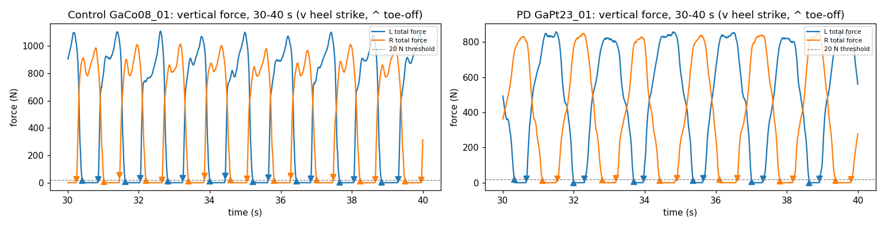
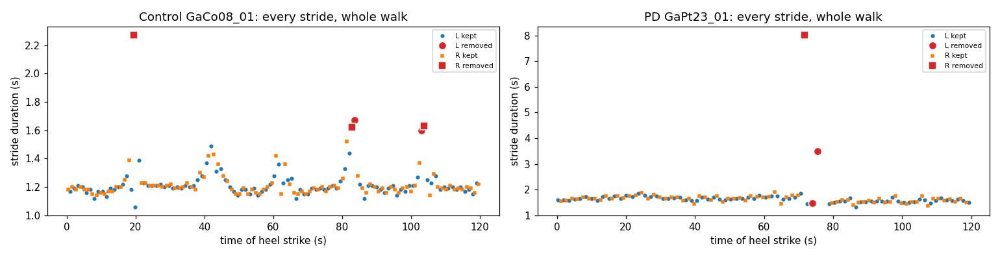
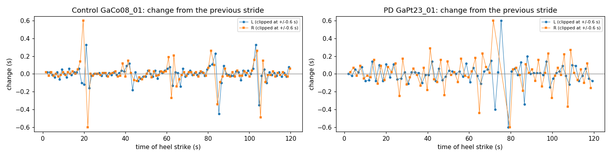
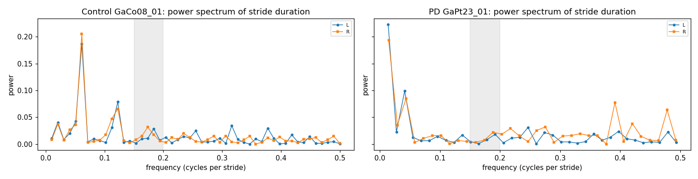
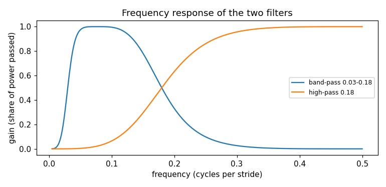
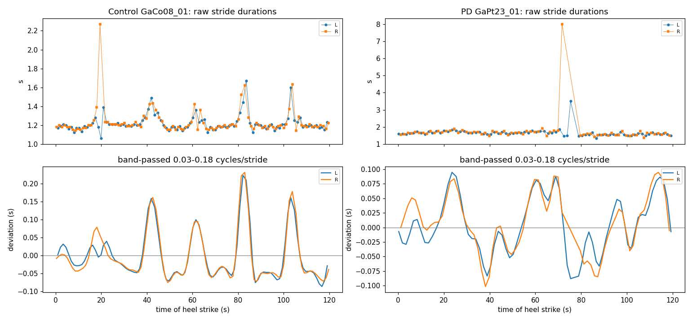
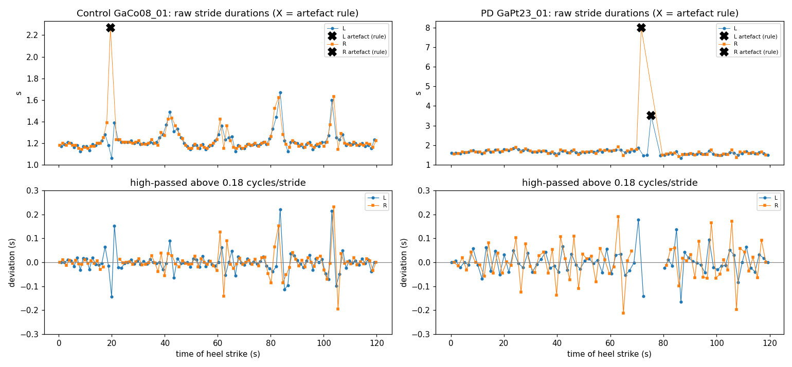
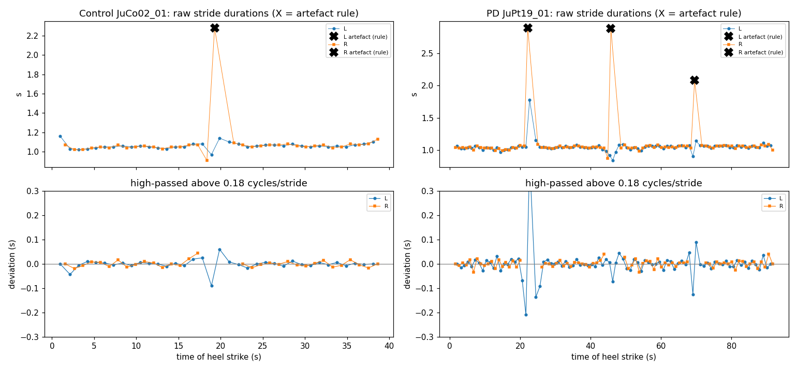
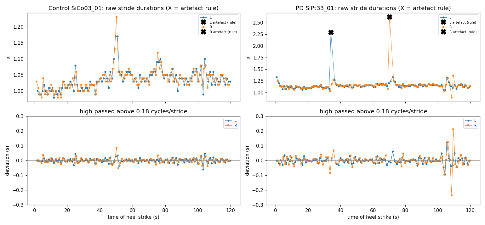

# T-017 exploration: what the stride rules remove, and filtering the stride series

_Exploratory work for T-017 (pre-processing), on the gaitpdb usual walks. Nothing in `src/` was changed and no model uses these results. Draft by A. Klygina; interpretation sections marked **[Anna]** are still to be written._

Every figure and number here is produced by

    python scripts/explore_stride_rules.py

which writes the figures to `figures/explore_stride_rules/` and every number to `results/explore_stride_rules.txt` (section numbers below refer to that file). The example participants are chosen by the script: for each sub-study, the PD participant and the control whose share of removed strides is closest to their group's median. Six participants are shown, so the figures illustrate; they do not establish anything about the cohort.

## 1. The question

The current stride rules (`src/gaitpdb/events.py`) keep a stride only if it lasts 0.5 to 2.5 s, its swing phase is 10 to 70% of the stride, and it is within 0.7 to 1.3 times the median stride of that foot in that recording. The methods also call for removing turn strides. This exploration asks what the rules actually remove, whether they treat PD participants and controls differently, and whether a filter on the stride-duration series can separate turns from the stride-to-stride variability that may characterise PD gait.

**[Anna]**

## 2. How much the rules remove, by group

Share of strides removed per analysed usual walk, by sub-study and group, with a Mann-Whitney test between groups: `results/explore_stride_rules.txt`, section 1.

**[Anna]**

## 3. Raw force: a PD participant and a control

Ga pair. The sensor-by-sensor values of one PD stance phase (left foot, sensors L1 heel to L8 toes) are in section 2 of the results file; no filtering or smoothing is applied anywhere in `src/`.

**[Anna]**

## 4. Stride durations: what is kept and what is removed

**[Anna]**

## 5. Stride-to-stride differences

Values beyond ±0.6 s are clipped in the figure; RMS per foot in section 3.

**[Anna]**

## 6. Power spectra of the stride series

The stride series is indexed by stride number, one sample per stride (frequencies 0 to 0.5 cycles per stride). Strides outside the hard limits or close to twice the median are set to the median first. Strongest peaks in section 4. The grey band (0.15 to 0.2) is the candidate cut-off.

**[Anna]**

## 7. Butterworth filters on the stride series

Both filters are 2nd-order Butterworth filters applied forward and backward (`scipy.signal.filtfilt`, zero phase), so the gain is the squared magnitude response and the cut-off is the half-power point.

Gains at selected frequencies: section 5.

### 7a. Band-pass 0.03 to 0.18 cycles per stride (detecting turns)

**[Anna]**

### 7b. High-pass above 0.18 cycles per stride (keeping step-to-step variability)

Strides marked X are flagged by a provisional artefact rule (outside 0.5 to 2.5 s, or 1.75 to 2.25 times the median); they and their neighbours are left out. Stride-time variability by the current rules and after the high-pass, per foot: section 6.

**[Anna]**

## 8. Si walk 01: overground or treadmill?

The Si sub-study comes from a study of treadmill walking in PD (Frenkel-Toledo et al., Mov Disord 2005 **[UNVERIFIED: reference not yet checked into `report/midterm/sources.md`]**), which recorded unassisted, walker and treadmill walking. Walking speed of the Si recordings against the paper's three conditions: section 7.

**[Anna]**

## 9. Open questions for the team

- **[Anna]** Turn detection: turn patterns differ by sub-study; the provisional "twice the median" artefact rule labels what look like pivot turns (Ju PD) as artefacts.
- **[Anna]** Our stride-time CV for the Si recordings is about twice the value the Si paper reports.
- **[Anna]** Si walk 01: confirm overground walking as a group (see the handoff note of 2026-10-23).
- Notebooks: the README says the project uses plain scripts, not notebooks. Interactive notebooks may be worth adopting for the model-training steps, where viewing and adjusting figures interactively helps. To discuss.
