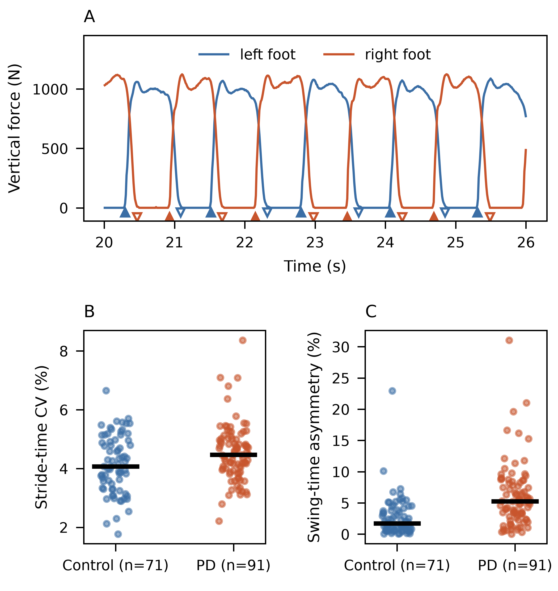

# Section 5. Preliminary Results

_Draft 6, 2026-10-14: on the 162 analysed participants (aged 50 or over, DECISIONS.md D-006), with the logistic regression's C grid widened to 1e-4 to 1e4. Draft 6 applies an independent review: every number was checked against its results file (all matched), and interpretive phrases were narrowed to what the files show (event detection "answered as far as the database allows", the stride-length inference now computed, stage 2 to 3 described as not covering the earliest disease). The live copy is the group's Word file; this file is the snapshot kept with the code. Sources of the numbers: `results/table1_participants.csv` and `results/table1_notes.txt` (`scripts/make_table1.py`); `results/figure1_summary.txt` and `results/features_usual_walk_by_group.csv` (`scripts/make_figure1.py`); `results/dual_task_check.txt` (`scripts/check_dual_task.py`); `results/event_detection_checks.csv` (`scripts/check_event_detection.py`); `results/model_comparison.csv`, `results/model_comparison_pairs.csv` (`scripts/compare_models.py`) and `results/logreg_coefficients.csv` (`scripts/run_logreg.py`). About 859 words plus the table and figure._

We downloaded version 1.0.0 of the PhysioNet database [S7] and wrote the loader, gait-event detection and feature code that the three models will share; every number, table and figure in this section is produced by a script in our repository (see its README). The uncertainty named in our proposal, whether the gait phases can be identified from the force signals alone, is answered as far as this database allows, since it has no reference event times: a foot is in contact while its total vertical force exceeds 20 N, heel strike and toe off are the crossings of that threshold, and duration rules, including one relative to each recording’s median stride, are designed to remove strides at turns, stops or with a dragged foot (Fig. 1A).

**Fig. 1.** A: total vertical force under each foot in one usual-walk recording (control GaCo01), with the detected heel strikes (▲) and toe offs (▽) of the kept strides. B: stride-time variability (coefficient of variation) and C: swing-time asymmetry between the legs, one point per analysed participant on the usual walk; bar at the median. From scripts/make_figure1.py.

Table I describes the 162 participants we analyse: everyone with a recording who is aged 50 or over (Section IV). Three points in it shape the plan. The controls are younger than the patients (64.1 vs 66.9 years; 58.7 vs 62.3 in the Si sub-study), although the PhysioNet description gives 66.3 years for both groups [S7], so age has to be accounted for in every model comparison. The patients are at Hoehn and Yahr stage 2 to 3, none at stage 1, so our results do not cover the earliest disease, in which clinical diagnosis is weakest [S1]. And 54 participants contribute more than one recording; we use one usual walk per participant and split by participant, so no person is ever on both sides of a split [S12].

**Table I.** Analysed participants of the PhysioNet database (aged 50 or over) and their recordings.

| Study | Group | n | Rec. | Age (y) | Women | H&Y | UPDRS motor |
|---|---|---:|---:|---|---:|---|---|
| Ga | PD | 29 | 75 | 71.1 ± 8.1 | 9 | 2 (2–3) | 17.9 ± 8.4 |
|  | Control | 18 | 38 | 71.6 ± 6.7 | 8 |  |  |
| Ju | PD | 28 | 103 | 68.0 ± 8.2 | 13 | 2.5 (2–3) | 15.9 ± 4.6 |
|  | Control | 25 | 25 | 64.7 ± 7.0 | 13 |  |  |
| Si | PD | 34 | 34 | 62.3 ± 7.8 | 12 | 2 (2–2.5) | 23.9 ± 7.2 |
|  | Control | 28 | 28 | 58.7 ± 5.8 | 10 |  |  |
| All | PD | 91 | 212 | 66.9 ± 8.8 | 34 | 2 (2–3) | 19.4 ± 7.7 |
|  | Control | 71 | 91 | 64.1 ± 8.2 | 31 |  |  |

_Age and UPDRS motor score: mean ± SD (UPDRS motor missing for two Si patients); Hoehn and Yahr (H&Y) stage: median (range). Rec.: recordings of all walk types; the analyses use one usual walk per participant. Excluded: JuCo10 (no recording) and three participants aged 36 to 45. From scripts/make_table1.py._

The pipeline reproduces the published dual-task effect: in the 21 Ga patients recorded both ways, stride-time variability rises under the counting task (p = 0.006), as the source study reported [S4]. On the usual walk, mean stride time and cadence do not differ significantly between the groups (p = 0.29 and 0.17), so the patients’ slower walking (1.03 vs 1.23 m/s in the database’s demographic table) comes mostly from shorter strides: speed times stride time gives 1.13 vs 1.34 m, a length the force signals alone cannot measure. Of the variability and asymmetry measures the literature points to [S3], [S13] (Fig. 1B, C), stride-time variability is slightly higher in PD (median coefficient of variation 4.5% vs 4.1%; AUC 0.60, p = 0.037) and no longer significant within the 60 to 80 year band (AUC 0.58, p = 0.15), whereas swing-time asymmetry separates the groups much better (5.3% vs 1.7%; AUC 0.76, p < 10−7), shows no correlation with age (Spearman ρ −0.05 in controls, −0.01 in PD), and holds within that band (AUC 0.75).

The research question stands; two findings changed the method. First, stride-time variability proved fragile: without the relative stride rule, occasional double-length strides (a dragged foot that never unloads) inflate it (control median coefficient of variation 7.4% against 4.1% with the rule), the group difference at 20 N was not significant (p = 0.22), and it moved with the contact threshold (AUC 0.51 at 10 N, 0.64 at 50 N); with the rule it barely moves (0.59 to 0.61). Second, swing-time asymmetry, one of the two strongest single features, weakens at a low threshold (AUC 0.67 at 10 N, against 0.76 at 20 N and 0.74 at 50 N), so before the cross-cohort test the threshold must be checked against WearGait-PD’s walkway contacts rather than carried over unchanged.

As a first model under the planned evaluation, a logistic regression on six timing features reaches an AUC of 0.82 (95% CI 0.75 to 0.90, corrected for the overlap between cross-validation training sets [S17]) and 0.77 (0.70 to 0.84) when each sub-study is held out in turn, a drop of 0.05 (0.02 to 0.09). Swing-time asymmetry (odds ratio 2.58 per SD of log(1 + x)) and the swing fraction of the stride (0.35) have the largest coefficients and the only bootstrap intervals that exclude 1. Asymmetry alone, with only the direction of its effect learned from the training participants, gives 0.76 both within and across protocols, so the other five features add 0.06 within a protocol (95% CI 0.01 to 0.11) but only 0.02 across protocols, with an interval that includes zero (−0.04 to 0.07). Age and sex alone give 0.59. The published participant-level result with gait features only (0.84 [S14]) is close to our within-protocol estimate, and the drop across protocols is the quantity this project is designed to measure.

These data can support a properly validated estimate of how well timing features alone separate PD from controls, within one database, across its three protocols and, with WearGait-PD, across cohorts. They cannot support a diagnostic claim, because every patient in both datasets already has a diagnosis and neither dataset includes people with other parkinsonian disorders [S7], [S9]. The most important remaining uncertainty is whether the event detection transfers to WearGait-PD, whose insoles, walking task (four passes along a 16 ft walkway) and age difference (controls older than patients) all differ from PhysioNet [S9]. Before the final submission we need to run the detection on WearGait-PD and check it against the walkway’s foot contacts, complete the SVM and random forest under the shared evaluation, and run the pooled and cross-cohort analyses (Section VI).
